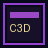

# Catacomb 3DS

**Unofficial New Nintendo 3DS port of Catacomb 3-D and Catacomb Abyss.**

---

## ☕ Support the project

If you enjoy the port and want to buy me a coffee, you can do it here. Every bit helps with future updates and projects. No pressure, of course.

**[ko-fi.com/xxnukem](https://ko-fi.com/xxnukem)**

---

## What is Catacomb 3DS?

**Catacomb 3DS** is an unofficial homebrew port of **Catacomb 3-D** and **Catacomb Abyss** for **New Nintendo 3DS**.

The project is based on [ReflectionHLE](https://github.com/ReflectionHLE/ReflectionHLE), adapted to run natively on the 3DS with a custom frontend, dual-screen support, native controls and ongoing work on stereoscopic 3D.

The goal is simple: make these early first-person fantasy shooters playable on real 3DS hardware in a way that feels natural on the console, while staying close to the original games.

## Current project status

This is still a **work in progress**.

Right now, the project is mainly focused on:

- Getting **Catacomb 3-D** and **Catacomb Abyss** running properly on New Nintendo 3DS.
- Adapting the games to the console's **two-screen layout**.
- Adding **native 3DS controls**.
- Improving presentation, compatibility and general usability.
- Experimenting with **stereoscopic 3D**.

Current state in broad terms:

- **Catacomb 3-D:** playable in the current port.
- **Catacomb Abyss:** working, but still being refined.
- **Other Catacomb titles:** not integrated yet as part of the public 3DS port.

Some systems are still under active work, especially menus, save handling, presentation details and overall polish.

## Features

- **Native New Nintendo 3DS homebrew port**
- Support for **Catacomb 3-D** and **Catacomb Abyss**
- **Dual-screen layout** adapted for the console
- **Native 3DS controls**
- Work-in-progress **stereoscopic 3D**
- Real hardware oriented development and testing
- Based on the open-source **ReflectionHLE** project

## Controls

The control setup is being adapted specifically for the 3DS.

At the moment, the port includes native input handling and ongoing menu/control work. The final public control scheme may still change as the project is refined.

## Game data

**No original game data is included in this repository.**

You must provide your own original game files in order to run the port.

The repository only contains the source code and supporting files for the 3DS port.

## Build notes

This repository contains the source code for the port, along with 3DS-specific platform code, tests and technical notes.

Because the project is still evolving, the build process and setup may continue to change while the port is being stabilized.

## Known limitations

At this stage, expect rough edges.

Known areas still being worked on include:

- menu flow and presentation
- save/load behaviour
- compatibility details between supported game versions
- stereoscopic 3D tuning
- performance and visual polish in some situations

## Credits

**Nintendo 3DS port:** Carlos de la Barrera Pérez ([xXNukem](https://github.com/xXNukem))

**Original open-source base:** [ReflectionHLE](https://github.com/ReflectionHLE/ReflectionHLE)

**Original games:** Catacomb series by their original authors and rights holders.

This is an independent, unofficial homebrew project. It is not affiliated with Nintendo or the original rights holders.

## License and original project

This repository builds on top of ReflectionHLE and keeps the corresponding original notices and license material.

See:

- [README_UPSTREAM.md](README_UPSTREAM.md)
- [LICENSES/](LICENSES)

Please also note that **original game assets are not included** and remain the property of their respective rights holders.
