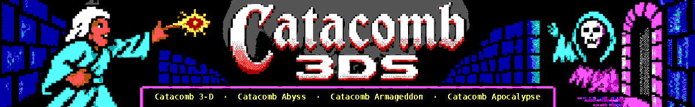

<div align="center">



**All four classic Catacomb games, playable on New Nintendo 3DS.**


</div>

---

<div align="center">

## ☕ Support the project

If you enjoy the port and want to buy me a coffee, you can do it here. Every bit helps with future updates and projects. No pressure, of course.

<a href="https://ko-fi.com/xxnukem"></a>

**[ko-fi.com/xxnukem](https://ko-fi.com/xxnukem)**

</div>

---

## What is Catacomb 3DS?

**Catacomb 3DS** is an unofficial native port of the four classic Catacomb first-person games to **New Nintendo 3DS**, built on the original game engines preserved by [ReflectionHLE](https://github.com/ReflectionHLE/ReflectionHLE) (formerly Reflection Keen).

The port adapts the games to the console's two screens, physical controls, touchscreen launcher and homebrew environment. It aims to retain the original gameplay and DOS assets rather than replace the games with approximations.

## Version 0.9 — first public beta

**All four games can be launched and played:**

| Game | Status |
|:--|:--|
| **Catacomb 3-D** | Playable |
| **Catacomb Abyss** | Playable |
| **Catacomb Armageddon** | Playable |
| **Catacomb Apocalypse** | Playable |

This is a **public beta, not a finished or fully validated release**. All four games are playable with tested DOS installations, but further testing, bug fixes and compatibility updates are needed. In particular, stereoscopic 3D still has visual issues, save/load behavior needs more testing, and some menus, transitions and edge cases may need revision. See [Known issues](#known-issues).

The port targets **New Nintendo 3DS / New Nintendo 3DS XL**. Other members of the 3DS family are not part of the supported hardware target.

## Installation

### 1. Download the homebrew executable

Obtain **`cat3ds-original.3dsx`** from the [GitHub Releases](https://github.com/xXNukem/Catacomb-3ds/releases) page, or [build it from source](#building-from-source).

Copy it to:

```text
sdmc:/3ds/catacomb-3ds/cat3ds-original.3dsx
```

Launch it with the Homebrew Launcher. The launcher creates the required game folders if they do not already exist; it does not erase existing files.

**Use `cat3ds-original.3dsx`**, not the older experimental `3ds.3dsx` frontend.

### 2. Supply your own DOS game data

**Original game files are not included in this repository or in the release.** You must provide your own legitimately obtained DOS copies. Copy the files from each installation into its corresponding folder:

```text
sdmc:/3ds/catacomb-3ds/
├── cat3ds-original.3dsx
├── games/
│   ├── cat3d/       # Catacomb 3-D
│   ├── catabyss/    # Catacomb Abyss
│   ├── catarm/      # Catacomb Armageddon
│   └── catapoc/     # Catacomb Apocalypse
├── saves/
├── saves-abyss/
├── saves-arm/
└── config/
```

Each game's directory should contain the **original gameplay EXE** and matching `AUDIO`, `EGAGRAPH` and `GAMEMAPS` archives. For example:

| Folder | Example gameplay EXE | Data-file extension |
|:--|:--|:--|
| `cat3d/` | `CAT3D.EXE` | `.C3D` |
| `catabyss/` | `CATABYSS.EXE` or `ABYSGAME.EXE` | `.ABS` |
| `catarm/` | `CATARM.EXE` | `.ARM` |
| `catapoc/` | `CATAPOC.EXE` | `.APC` |

The launcher checks file contents and game resource tables, not just filenames. Several DOS editions and compatible executable names are recognized, but **compatibility with additional DOS versions remains to be tested**. In particular, **Catacomb Abyss, Catacomb Armageddon and Catacomb Apocalypse may have problems with editions that have not been verified**. Recognizing a game installation does not guarantee that every level, menu or save/load path works with that edition. Avoid mixing files from different editions in the same folder. Copying the complete original DOS installation is recommended.

If an installation is not recognized, select it in the launcher and press **X** to inspect the file diagnostics, or **Y** to rescan after copying files.

### 3. Select a game

Use the D-pad to highlight a game and press **A** to launch it, or touch an available game in the bottom-screen list to start it directly. The upper screen displays the title artwork; the lower screen shows installation status and controls.

## Launcher controls

| Input | Action |
|:--|:--|
| D-pad Up / Down | Select a game |
| A | Launch selected game |
| Touchscreen | Select and launch an available game with one touch |
| X | Show installation details |
| B | Return from details |
| Y | Rescan the game folders |
| START | Exit confirmation |

In-game controls and the interface are adapted for New Nintendo 3DS; further refinements may follow.

## Known issues

- **More DOS versions need testing:** Full compatibility has not been established for all releases. This is especially relevant to **Abyss, Armageddon and Apocalypse**, where some editions may exhibit problems with startup, gameplay or save/load. Please include the exact DOS version when reporting issues.
- **Stereoscopic 3D is experimental.** Depth, ghosting, screen transitions and some visual effects require further work. Monoscopic play is the recommended option if 3D causes discomfort or visual artifacts.
- **Save and load:** The unified save-slot interface is implemented, but saving and restoring progress still need broader testing across all four games and DOS editions. Back up important saves before updating.
- **Menus and transitions:** Some in-game messages, death screens, transitions or other edge cases may still behave differently from the DOS originals.
- **Compatibility and stability:** Gameplay sequences, level transitions and game-switching paths have not been exhaustively tested on hardware. Additional bug fixes and reviews are expected.

Please report reproducible problems through [GitHub Issues](https://github.com/xXNukem/Catacomb-3ds/issues), including the game, DOS edition and steps to reproduce the issue.

## Building from source

Requirements:

- [devkitPro](https://devkitpro.org/) with the Nintendo 3DS toolchain and libctru
- CMake 3.20 or newer
- A working devkitARM installation
- Internet access for the initial SDL3 source download, if it is not cached

From the repository root:

```sh
export DEVKITPRO=/opt/devkitpro   # Adjust if installed elsewhere
export DEVKITARM="$DEVKITPRO/devkitARM"
bash platform/3ds/tools/build_original_sdl3.sh
```

The primary output is:

```text
platform/3ds/cat3ds-original.3dsx
```

For local wireless testing with the Homebrew Launcher and `3dslink`:

```sh
3dslink platform/3ds/cat3ds-original.3dsx
```

The separate `platform/3ds/Makefile` builds the older experimental frontend, not the four-game original-engine executable described here.

## Development and use of AI

AI-assisted tools were used during development to **study and understand the ReflectionHLE / Reflection Keen codebase**, investigate legacy game behavior, and assist with implementing portions of the port.

**Human work was central to the project:** the developer reviewed AI-generated code, performed hands-on testing on real Nintendo 3DS hardware, diagnosed issues, made design and implementation decisions, and also wrote original code. AI assistance does not replace responsibility for the code included in this repository.

The project is an independent preservation and porting effort, not an official product of the original game developers or Nintendo.

## Credits

**Nintendo 3DS port:** Carlos de la Barrera Pérez ([xXNukem](https://github.com/xXNukem)).

**Original games:** id Software, the original Catacomb developers and publishers.

**Source-port foundation:** [ReflectionHLE](https://github.com/ReflectionHLE/ReflectionHLE) and its contributors. Original copyrights and notices are retained.

## License and original game data

The project retains the upstream licensing and attribution material. See [README_UPSTREAM.md](README_UPSTREAM.md), [AUTHORS.md](AUTHORS.md), and [LICENSES/](LICENSES/).

**No commercial or proprietary DOS game data is distributed with this project.** You must supply your own original game files, which remain the property of their respective rights holders.
